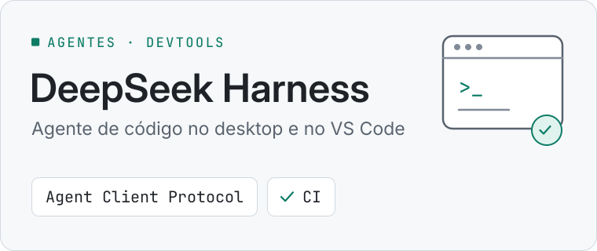

<picture>
  <source media="(prefers-color-scheme: dark)" srcset="docs/assets/cover-pt-dark.svg">
  
</picture>

<p align="center">
  <a href="README.md">English</a> | Português (Brasil)
</p>

<p align="center">
  <a href="https://github.com/YanCarneosso/deepseek-harness-desktop/actions/workflows/ci.yml"></a>
  <a href="LICENSE"></a>
  
</p>

Integração desktop do [DeepSeek Harness](https://github.com/deepseek-ai/deepseek-harness) (`dsh`)
para Linux: abra pelo menu de aplicativos como app em janela própria, converse com ele dentro do
VS Code e gerencie as configurações global e por projeto.

> **Projeto não oficial.** Sem vínculo, endosso ou suporte da DeepSeek.
> O DeepSeek Harness está em *developer preview*; espere mudanças incompatíveis no projeto original.

## Em 30 segundos

- **O que é:** integração desktop para Linux do DeepSeek Harness, um agente de programação: janela
  de aplicativo própria, atalho no menu de aplicativos e chat dentro do VS Code.
- **Como funciona:** modo app do Chromium com perfil isolado; extensão do VS Code que usa o Agent
  Client Protocol (chamadas de ferramentas, diffs, pedidos de permissão, escolha de modelo e de
  esforço de raciocínio); uma instância por pasta, cada uma na sua porta; configuração em camadas,
  global e por projeto.
- **Engenharia:** instalação por usuário sem root, versão do `dsh` fixada, CI no GitHub Actions,
  guias de contribuição e segurança, documentação em inglês e português.
- **Stack:** Bash · JavaScript (API de extensões do VS Code) · Node.js · Make
- **Por onde começar:** [arquitetura](docs/architecture.md) · [README da extensão](vscode-extension/README.md)

## Recursos

- **App em janela própria**: a interface web do dsh abre numa janela Chromium `--app`, com perfil
  isolado e ícone próprio na barra de tarefas (inclusive no Wayland). Fechar a janela para o servidor
  que ela iniciou.
- **Atalho no menu de aplicativos** com as ações *Parar* e *Editar configuração global*.
- **Chat no VS Code**: converse com o agente dsh num chat na barra lateral, como nas extensões do
  Claude Code, Codex e OpenCode, pelo protocolo padrão Agent Client Protocol. Mostra ferramentas,
  diffs e pedidos de permissão, e permite escolher modelo e esforço de raciocínio. Interface em
  inglês e português.
- **Uma instância por pasta**, cada uma na sua porta (a partir de 3080), compartilhada entre menu,
  VS Code e terminal.
- **Configuração global e local**: `~/.dsh/cordis.patch.yml` para todos os projetos e
  `<projeto>/.dsh/cordis.patch.yml` para um projeto, na ordem de camadas do próprio dsh.
- **Versão do dsh fixada**, instalada por usuário, sem root.

## Requisitos

- Linux com menu de aplicativos freedesktop (KDE Plasma, GNOME, …)
- Node.js e npm (versão suportada pelo `@deepseek-ai/dsh`)
- Navegador baseado em Chromium para o modo app (Chromium, Google Chrome, Brave, Vivaldi ou Edge);
  sem ele, use o modo aba
- Opcional: VS Code (`code` no `PATH`) para a extensão
- Uma chave de API da DeepSeek

## Instalação

```sh
git clone https://github.com/YanCarneosso/deepseek-harness-desktop.git
cd deepseek-harness-desktop
./install.sh
```

O instalador coloca:
- o `@deepseek-ai/dsh` (versão fixada) em `~/.local/lib/dsh`;
- o launcher `deepseek-harness` e um wrapper `dsh` em `~/.local/bin`;
- o atalho e o ícone em `~/.local/share`;
- e a extensão no VS Code.

Opções: `--dsh-version VERSÃO`, `--skip-dsh`, `--skip-vscode` e `--dev` (liga o launcher ao
checkout em vez de copiar).

Depois, informe sua chave de API ao dsh de uma destas formas:

- `DEEPSEEK_API_KEY=...` em `~/.dsh/.env`;
- Settings → Models, dentro do app;
- `DSH_DESKTOP_KEY_COMMAND` nas preferências do launcher, apontando para um comando que imprime a
  chave (por exemplo, de um gerenciador de senhas).

## Uso

- **Menu**: abra *DeepSeek Harness*.
- **VS Code**: recarregue a janela e abra o chat **DeepSeek Harness** pela barra de atividades ou
  clique em **DeepSeek** na barra de status. Veja o [README da extensão](vscode-extension/README.md).
- **Terminal**:

```sh
deepseek-harness start                 # pasta atual, janela de app
deepseek-harness start --dir ~/proj --tab
deepseek-harness status --all
deepseek-harness stop --all
deepseek-harness config global --edit  # ~/.dsh/cordis.patch.yml
deepseek-harness config local --edit   # ./.dsh/cordis.patch.yml
deepseek-harness config show           # configuração efetiva
```

Detalhes (em inglês):
- [docs/configuration.md](docs/configuration.md): camadas de configuração e preferências;
- [docs/architecture.md](docs/architecture.md): como o projeto funciona;
- [docs/troubleshooting.md](docs/troubleshooting.md): solução de problemas.

## Desinstalação

```sh
./uninstall.sh               # mantém ~/.dsh, o dsh e suas preferências
./uninstall.sh --remove-dsh --purge
```

O `~/.dsh` (sessões, perfis e credenciais) nunca é removido.

## Contribuindo

Issues e pull requests são bem-vindos; veja [CONTRIBUTING.md](CONTRIBUTING.md). Problemas de
segurança: [SECURITY.md](SECURITY.md).

## Licença

[MIT](LICENSE). O DeepSeek Harness é um projeto separado, com licença própria.
